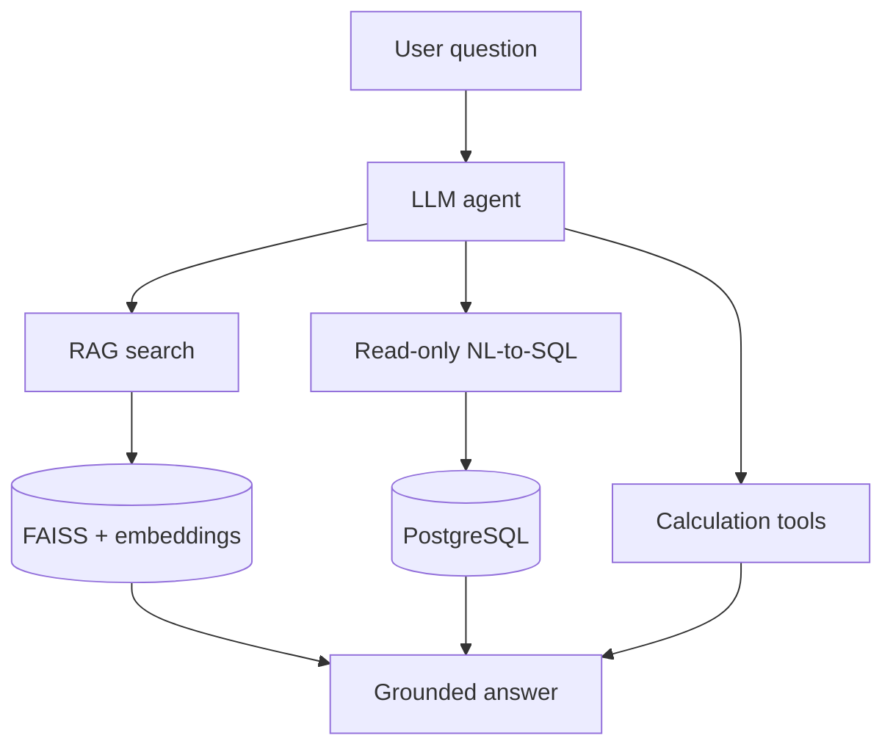

<h1 align="center">Hi, I’m Ankit Kumar 👋</h1>

  Python AI Developer · Agentic Systems · RAG · MCP · Production AI Workflows

  <a href="https://www.linkedin.com/in/techankit10/">LinkedIn</a> ·
  <a href="https://github.com/iankit-sachan?tab=repositories">All repositories</a>

## Building AI systems that ship

I build **agentic AI applications** that connect LLMs to real data, tools, and production workflows. My work spans RAG, natural-language-to-SQL, MCP integrations, secure API design, and AI-assisted automation.

- 🧠 **Agentic AI:** RAG, tool calling, multi-step workflows, and prompt engineering
- ⚙️ **Production systems:** FastAPI, Django, Celery, WebSockets, HMAC webhooks, and idempotency
- 🔒 **Reliable AI:** read-only SQL controls, validation, structured outputs, and offline tests

## Agentic AI blueprint

## Selected AI systems

| Project | What I built | Core stack |
| --- | --- | --- |
| [**Company AI Assistant**](https://github.com/iankit-sachan/company-ai-assistant) | Agentic Q&A over documents and live data, with secure RAG and natural-language-to-SQL tools. | FastAPI · FAISS · PostgreSQL · OpenAI/Ollama · React · Docker |
| [**AI Resume Analyzer**](https://github.com/iankit-sachan/ai-resume-analyzer) | Hybrid resume analysis using rule-based checks, OCR, and Gemini scoring. | Django REST · Gemini · Pydantic · JWT · PostgreSQL/SQLite |
| **Brandnio / PromoPe** | Multi-agent platform, AI poster generation, CRM workflows, and scheduled WhatsApp delivery. | Claude API · MCP · Celery · WhatsApp Business API · HMAC |

<strong>🧠 Company AI Assistant — open architecture</strong>

- Multi-format document ingestion with chunking, Sentence Transformers embeddings, and FAISS retrieval.
- LLM tool calling routes requests to RAG search, validated read-only SQL, or calculator tools.
- Built as a full-stack application with FastAPI, React 19, PostgreSQL, Docker Compose, and offline pytest coverage.

<strong>📄 AI Resume Analyzer — open pipeline</strong>

- PDF, DOCX, and TXT processing with OCR fallback for scanned documents.
- Eighteen rule-based dimensions combined with Google Gemini for structured scoring and job-match analysis.
- Django REST API with JWT authentication and Pydantic-validated JSON output.

<strong>⚙️ Production automation at PromoPe — open workflow</strong>

- AI-assisted poster generation using the Claude API and prompt optimisation.
- Hourly Celery delivery pipeline through the WhatsApp Business API.
- HMAC-signed status webhooks, real-time tracking, and idempotency guards for reliable processing.

## Skills

**Agentic & LLM:** `RAG` · `LangChain` · `LangGraph` · `MCP` · `LLM tool calling` · `Prompt engineering` · `Claude API` · `OpenAI` · `Ollama` · `Google Gemini`

**Backend & data:** `Python` · `FastAPI` · `Django REST Framework` · `REST APIs` · `WebSockets` · `PostgreSQL` · `FAISS` · `SQL` · `MongoDB` · `SQLite`

**Production & integration:** `Docker` · `Celery` · `JWT` · `HMAC webhooks` · `WhatsApp Business API` · `Pydantic` · `OCR` · `GitHub Actions` · `AWS`

<strong>Certifications</strong>

- AWS Cloud Practitioner Essentials · 2026
- Model Context Protocol (MCP) · Coursera · 2026
- Developing AI Applications with Python and Flask · IBM · 2025
- Prompt Design in Vertex AI · Google Cloud · 2025
- Django Web Framework · Meta · 2025

---

Building useful AI systems from prototype to production.

